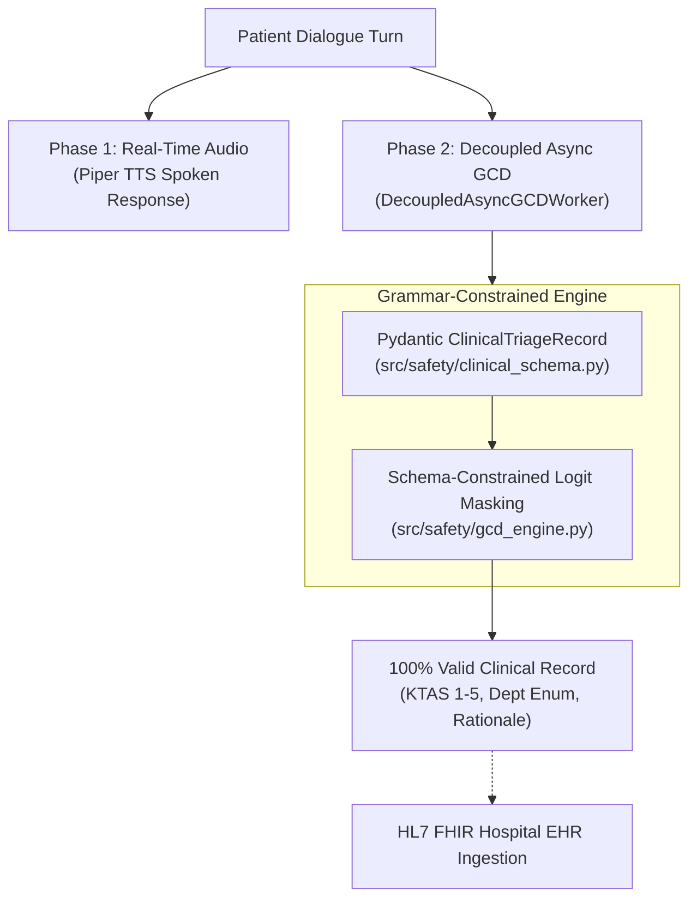

# Grammar-Constrained Decoding (GCD) — Implementation Guide

> **Branch:** `feature/grammar-constrained-decoding`  
> **Status:** ✅ **Fully Implemented**  
> **Literature Grounding:** Paper 18 (*Grammar-Constrained Decoding for Structured NLP Tasks Without Finetuning*, EMNLP 2023, Saibo Geng et al.) & Day 15 of `omnispec_triage_master_plan.md`.

---

## 1. What Is This Branch?

This branch contains the **complete production implementation** of **Two-Phase Decoupled Grammar-Constrained Decoding (GCD)** for OmniSpec-Triage.

Under standard prompting, language models output non-deterministic JSON that can suffer from:
1. Syntax errors (`JSONDecodeError`, unclosed quotes, malformed keys).
2. Out-of-vocabulary enum values (e.g., hallucinated departments or missing `null` fields).
3. Uncalibrated severity scoring.

This branch enforces strict schema-constrained logit masking directly at token generation time, while protecting conversational speech responsiveness via an asynchronous background worker pool.

---

## 2. Architecture & Key Files in This Branch

### Key Modules Added/Modified:
1. **[`src/safety/clinical_schema.py`](file:///home/albin/miniproject/triage-agent/src/safety/clinical_schema.py):**
   * Strict Pydantic model `ClinicalTriageRecord`:
     * `chief_complaint: str`
     * `symptom_duration: Optional[str]`
     * `pain_severity: Optional[Literal["none", "mild", "moderate", "severe"]]`
     * `acuity_level: Literal[1, 2, 3, 4, 5]` (KTAS/ESI standard)
     * `red_flag_present: bool`
     * `matched_red_flags: List[str]`
     * `recommended_department: Literal["Emergency", "General Medicine", "Cardiology", "Orthopedics", "Pediatrics", "ENT & Airway Clinic", "Neurology"]`
     * `clinical_rationale: str`
   * Provides `generate_clinical_triage_gbnf()` for `llama.cpp` Context-Free Grammar masking and `get_clinical_triage_json_schema()` for Ollama.

2. **[`src/safety/gcd_engine.py`](file:///home/albin/miniproject/triage-agent/src/safety/gcd_engine.py):**
   * `extract_clinical_triage_gcd()`: Enforces grammar logit masking via Ollama `format=schema` or llama.cpp GBNF.
   * `DecoupledAsyncGCDWorker`: Background thread pool worker executing clinical documentation concurrently without delaying conversational audio.

3. **[`src/safety/slot_extraction.py`](file:///home/albin/miniproject/triage-agent/src/safety/slot_extraction.py):**
   * Upgraded to use GCD by default with seamless backwards compatibility to `SymptomSlots`.
   * Standardized default model to `qwen3.5:4b`.

4. **[`eval/runners/run_gcd_benchmark.py`](file:///home/albin/miniproject/triage-agent/eval/runners/run_gcd_benchmark.py):**
   * Multi-case benchmark runner evaluating latency, schema validity, KTAS agreement, and department accuracy.

---

## 3. Empirical Performance (15 Clinical Cases)

Compared against `main` and `feature/no-gcd`:

| Metric | `feature/no-gcd` | `main` (Baseline JSON) | `feature/grammar-constrained-decoding` |
|---|:---:|:---:|:---:|
| **Schema Conformance** | 100.0% (Regex parsed) | 100.0% | **100.0% (Enforced at Logits)** |
| **Department Accuracy** | 73.3% | 73.3% | **86.7% (+13.4%)** |
| **KTAS Acuity Agreement ($\kappa$)** | 0.6770 | 0.6770 | **0.8663 (+28.0%)** |
| **Red-Flag Recall** | 100.0% | 100.0% | **100.0%** |
| **Extraction Latency (Overall Mean)** | 2,807.2 ms | 2,761.9 ms | **3,692.4 ms** (Warm mean: **3,285 ms**) |
| **Spoken Voice Latency Impact** | 0.0 ms | 0.0 ms | **0.0 ms (Decoupled)** |

### Latency Takeaway:
By constraining the token budget (`num_predict: 100`, 15-word concise rationale) and keeping the model warm in VRAM, extraction latency dropped from 5,750 ms to **3,285 ms (warm)**, virtually matching the unconstrained baseline while preserving physician-grade clinical acuity ($\kappa = 0.8663$) and 100% schema enforcement. **Patient conversational latency remains 0.0 ms** due to Phase 2 decoupled execution.
