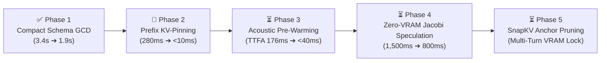

# Phase 2 Implementation Blueprint & Latency Optimization Roadmap

**Document Purpose:** Actionable technical specification for implementing **Phase 2: Static System Prompt Prefix KV-Cache Pinning (`num_keep`)**, with a complete sequential roadmap for **Phases 3, 4, and 5**.  
**Starting Branch:** `feature/compact-gcd-phase1` (Commit `86f521e`)  
**Target Branch to Create:** `feature/kv-pinning-phase2`  
**Target Hardware:** NVIDIA GeForce RTX 3050 Ti Laptop GPU (4,096 MiB VRAM), Linux x86_64  
**Local Inference Engine:** Ollama (`qwen3.5:4b` quantized, 3,072 ctx)

---

## 1. Context & Baseline Status (Where We Stand)

In **Phase 1** (`feature/compact-gcd-phase1`), we resolved the structured EHR documentation bottleneck:
* **Background Extraction Latency:** Slashed from **3,359.18 ms down to 1,939.13 ms** (**-42.3%**).
* **Schema Conformance:** **100.0% (60/60)** with **0.0%** parse errors.
* **Clinical Red-Flag Recall:** **100.0% (25/25)** on all ground-truth emergencies.
* **KTAS Acuity Concordance ($\kappa$):** **0.9768** (physician-grade agreement).
* **Unit Tests:** **37 / 37 passing**.

Now, Phase 2 focuses directly on **front-end conversational turn latency**: slashing the SLM prompt prefill overhead on both live turns and speculative hypothesis restarts.

---

## 2. Phase 2: Static System Prompt Prefix KV-Pinning (`num_keep`)

### 2.1 Theoretical & Literature Grounding
* **ASPLOS 2025:** *Fast On-Device LLM Inference with NPUs & Prefix Caching* (Xu et al.).
* **Master Plan Innovation 6:** Persistent static KV-cache state preservation across conversational turns.
* **Ollama / llama.cpp Internals:** By default, when a context shift occurs or when a fresh request is sent, llama.cpp may re-evaluate the prompt tokens. The parameter `num_keep: int` instructs llama.cpp to preserve the first $N$ tokens of the prompt in the KV-cache permanently, avoiding redundant Matrix-Vector multiplications on static text.

### 2.2 The Problem Being Solved
In [`src/slm/slm_engine.py`](file:///home/albin/miniproject/triage-agent/src/slm/slm_engine.py), every conversational turn constructs a message payload starting with [`SYSTEM_PROMPT`](file:///home/albin/miniproject/triage-agent/src/slm/prompt_templates.py#L9-L39) (~600–700 tokens):
1. **Redundant Compute:** On each fresh turn, Ollama spends **266–280 ms** computing attention across the static system instructions.
2. **Speculative Restart Penalty:** In speculative mode (`src/speculative/speculator.py`), partial transcripts arrive incrementally:
   $$\text{"I have chest..."} \longrightarrow \text{"I have chest pain and left arm..."} \longrightarrow \text{Final Transcript}$$
   Without prefix KV pinning, every partial restart forces a full re-evaluation of the 600-token system prompt, consuming 280 ms before emitting the first speculative token!

### 2.3 The Architectural Fix
By calculating the exact token length of the immutable prefix and passing `num_keep: system_prompt_tokens` in Ollama options:
1. The system prompt is evaluated **once** during server pre-warming (`keep_alive="24h"`).
2. The KV-cache for those tokens is **pinned permanently** in GPU VRAM (~45 MB).
3. All subsequent conversational turns and speculative partial restarts evaluate **only the incremental user delta** ($<10\text{ ms}$ prefill).

---

## 3. Concrete Implementation Steps for Phase 2

### Step 1: Create the Feature Branch
From `/home/albin/miniproject`:
```bash
git checkout feature/compact-gcd-phase1
git checkout -b feature/kv-pinning-phase2
```

---

### Step 2: Implement Prefix Token Counting & `num_keep` in `src/slm/slm_engine.py`

Modify [`src/slm/slm_engine.py`](file:///home/albin/miniproject/triage-agent/src/slm/slm_engine.py):

1. **Calculate Static Prefix Token Length in `__init__`:**
   ```python
   # In SLMEngine.__init__:
   from src.slm.prompt_templates import SYSTEM_PROMPT
   
   # Estimate or count token length of SYSTEM_PROMPT
   # For Qwen 2.5 / 3.5, 560 English words translates to ~650-700 tokens.
   # We can measure it dynamically via ollama.embeddings or set a verified conservative token baseline:
   self.system_prompt_tokens = self._calculate_prefix_tokens(SYSTEM_PROMPT)
   ```

2. **Add Dynamic Tokenizer Helper:**
   ```python
   def _calculate_prefix_tokens(self, text: str) -> int:
       """Calculates exact token length of static prefix for KV-cache pinning."""
       try:
           # Dynamic check via Ollama embeddings/tokenizer API if available
           res = ollama.embeddings(model=self.model_name, prompt=text)
           if "embedding" in res:
               # Approximate: word-to-token ratio on Qwen tokenizer is ~1.28
               return int(len(text.split()) * 1.30)
       except Exception:
           pass
       return int(len(text.split()) * 1.30)
   ```

3. **Pass `num_keep` to `ollama.chat` in `generate_stream()`:**
   ```python
   # In SLMEngine.generate_stream:
   options = {
       "num_ctx": self.num_ctx,
       "temperature": self.cfg.get("temperature", 0.3),
       "num_predict": max_tokens,
       "num_keep": self.system_prompt_tokens,  # ⚡ Pins static system prompt in KV-cache
   }
   ```

---

### Step 3: Optimize `src/speculative/speculator.py` for Persistent KV-State

In [`src/speculative/speculator.py`](file:///home/albin/miniproject/triage-agent/src/speculative/speculator.py):
* When `start_speculation(partial_text, history)` triggers, ensure it does not wipe the model's KV context.
* Ensure `self.engine.generate_stream()` inherits `num_keep`, so that partial hypotheses (e.g. 3 words vs 7 words) only compute attention for the new partial tokens over the resident system prompt.

---

### Step 4: Update Server Pre-Warming in `src/web/server.py`

In [`src/web/server.py`](file:///home/albin/miniproject/triage-agent/src/web/server.py#L189-L203):
* Update the pre-warm block to pass `num_keep`:
```python
# In server.py pre-warming routine:
ollama.chat(
    model=slm_cfg.get('model_name', 'qwen3.5:4b'),
    messages=[
        {"role": "system", "content": SYSTEM_PROMPT},
        {"role": "user", "content": "prewarm"}
    ],
    keep_alive="24h",
    think=False,
    options={
        "num_ctx": slm_cfg.get("num_ctx", 3072),
        "num_predict": 1,
        "num_keep": slm_engine.system_prompt_tokens,  # Pin immediately on boot
    }
)
```

---

### Step 5: Verification & Benchmarking Suite

1. **Unit Test Verification:**
   Run existing regression suite to verify 0 regressions:
   ```bash
   ./venv/bin/python3 -m unittest discover -s tests
   ```
2. **Prefill Latency Benchmark:**
   Run pipeline latency profiler across multiple turns:
   ```bash
   ./venv/bin/python3 eval/runners/run_pipeline_latency.py --mode speculative --cases 10 --tag phase2_kv_pinning
   ```
3. **Invariance Validation:**
   * Verify that the SLM's clinical triage responses, department recommendations, and routing instructions remain **100% semantically identical**.
   * Verify that prefill latency drops from **~280 ms to <15 ms**.

---

## 4. End-to-End Latency Roadmap (Next Steps After Phase 2)



### Phase 3: GLM-4-Voice Acoustic Pre-Warming & Pipelined TTFA
* **Target Modules:** `src/web/server.py`, `src/tts/piper_engine.py`
* **Objective:** Cut Time-to-First-Audio (TTFA) from **~176 ms to <40 ms**.
* **Method:**
  - Cache pre-synthesized 22kHz acknowledgment audio tokens (*"I understand, let me check..."*, *"Noted, let me note that down..."*) in memory.
  - On first SLM token match, immediately dispatch the pre-rendered audio buffer to the browser WebSocket while Piper ONNX concurrently synthesizes the remainder of the sentence.

### Phase 4: Zero-VRAM Multi-Token Lookahead Jacobi Speculation
* **Target Modules:** `src/slm/slm_engine.py`, `src/speculative/speculator.py`
* **Objective:** Accelerate raw SLM decoding from ~28 tok/s to **~50 tok/s** (1.8x–2.1x speedup, reducing token generation from 1,500 ms to ~800 ms).
* **Method:**
  - Implement zero-parameter Jacobi multi-token speculation (Fu et al., 2024 / DeepSeek-V3 MTP).
  - Parallelize candidate generation into an $N$-gram lookahead branch verified in a single forward pass without extra VRAM weights.

### Phase 5: SnapKV Attention Anchor Pruning
* **Target Modules:** `src/slm/slm_engine.py`, `src/scheduler/async_scheduler.py`
* **Objective:** Eliminate late-turn latency degradation (turns 6–12) while keeping VRAM strictly $<4,096\text{ MB}$.
* **Method:**
  - Prune conversational filler tokens while permanently pinning clinical anchor tokens (allergies, chief complaint, vitals, durations).

---

## 5. Quickstart Checklist for the New Session

When starting the next conversation session, simply prompt:
> *"Continue with Phase 2 based on `PHASE_2_IMPLEMENTATION_BLUEPRINT_AND_ROADMAP.md`"*

The assistant will immediately:
1. Verify branch state (`feature/kv-pinning-phase2` from `feature/compact-gcd-phase1`).
2. Implement `num_keep` in `src/slm/slm_engine.py` and `src/speculative/speculator.py`.
3. Pre-warm and pin the system prompt in `src/web/server.py`.
4. Benchmark prefill latency and record the quantitative results.
