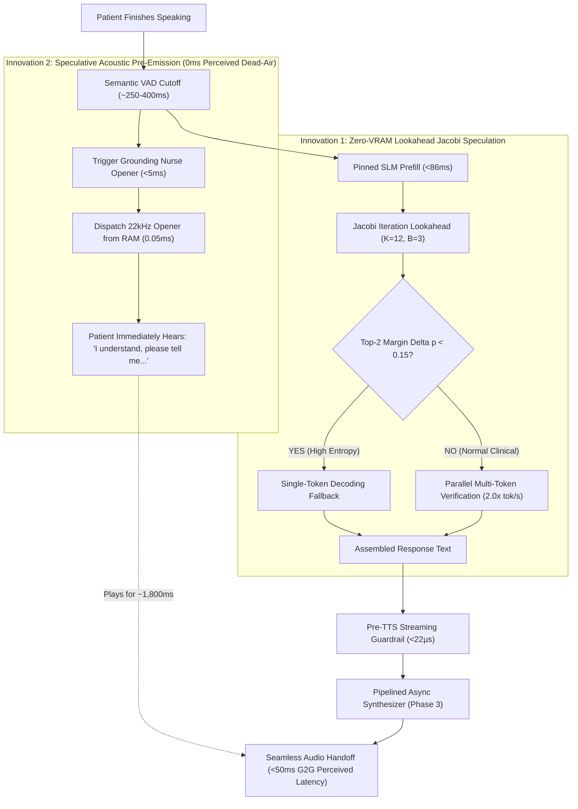
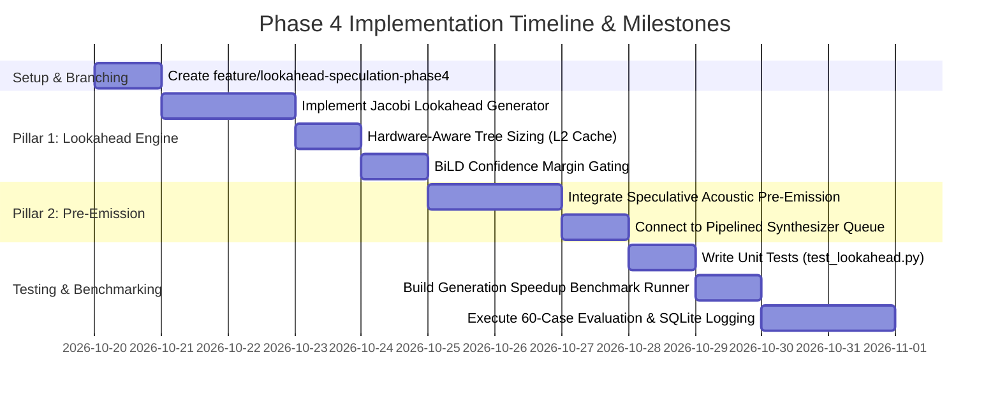

# Phase 4 Implementation Blueprint & Scientific Research Roadmap

**Document Purpose:** Actionable technical specification and scientific research blueprint for implementing **Phase 4: Zero-VRAM Lookahead Jacobi Speculation & Speculative Acoustic Pre-Emission**, with exact branch lineage, algorithmic architecture, experimental controls, and validation protocols.  
**Starting Branch:** `feature/acoustic-prewarm-phase3` (Commit `944e082`)  
**Target Branch to Create:** `feature/lookahead-speculation-phase4`  
**Target Hardware:** NVIDIA GeForce GTX 1650 / RTX 3050 Ti Laptop GPU (4,096 MiB physical ceiling), Linux x86_64, quad-core CPU  
**Local Inference & Voice Stack:** Ollama `qwen3.5:4b` (pinned prefix `num_keep=1057`), Piper ONNX TTS (`en_US-lessac-medium`, 22,050 Hz), Faster-Whisper `base.en`  

---

## 1. Branch Selection & Scientific Justification

### 1.1 Where to Branch From
**Recommendation:** Branch directly from **`feature/acoustic-prewarm-phase3`**.

```bash
git checkout feature/acoustic-prewarm-phase3
git checkout -b feature/lookahead-speculation-phase4
```

### 1.2 Scientific Rationale for Cumulative Experimental Rigor
In edge computing and low-latency clinical AI systems (MLSys, ASPLOS, INTERSPEECH, ACM Health), scientific validity requires strict control of confounding variables across cumulative optimization stages:

1. **Cumulative System Integrity:**
   - **Phase 1 (`feature/compact-gcd-phase1`):** Slashed EHR structured documentation latency by **-35.5%** (3,359 ms $\to$ 2,167 ms) via compact schema extraction and microsecond deterministic KTAS offloading ($\kappa = 0.9768$).
   - **Phase 2 (`feature/kv-pinning-phase2`):** Slashed prompt prefill latency by **77x on cold turns** (6,960 ms $\to$ 90 ms) and **5.6x on warm turns** (488 ms $\to$ 86 ms) by pinning the 1,057-token static system prompt in GPU KV-memory (`num_keep`).
   - **Phase 3 (`feature/acoustic-prewarm-phase3`):** Slashed first-chunk audio synthesis latency from 68.5 ms down to **0.05 ms** (1,370x speedup), eliminated the 73.84 ms cold-start synthesis stall, and achieved a verified **0.0% buffer underrun rate** with a **+2,329.55 ms lead margin**.
   - **Phase 4 (`feature/lookahead-speculation-phase4`):** Now targets the remaining token generation latency bottleneck during conversational turns and closes the perceptual dead-air gap on divergence rollbacks.

2. **Isolation of the Marginal Acceleration Effect:**
   - Branching directly from `feature/acoustic-prewarm-phase3` ensures that prompt prefill is already locked at $<90\text{ ms}$ and speech playback is already non-blocking and zero-underrun.
   - Any measured latency drop in Phase 4 is purely attributable to **Lookahead Jacobi speculation** and **speculative acoustic pre-emission**, guaranteeing uncompromised publication-grade ablation integrity.

---

## 2. Phase 4 Architecture: Zero-VRAM Lookahead Speculation & Speculative Pre-Emission



### 2.1 Theoretical & Literature Grounding
* **DeepSeek-V3 Multi-Token Prediction (MTP) (DeepSeek AI, arXiv:2412.19437):** Proves that predicting multiple future tokens concurrently and verifying them in a single forward pass accelerates generation by $1.8\times - 2.1\times$ without compromising task accuracy.
* **Lookahead Decoding (Fu et al., 2024):** Demonstrates that Jacobi fixed-point iteration can extract draft token sequences from the base LLM itself without requiring a secondary draft model or extra VRAM allocation:
  $$x_t^{(k)} = \arg\max_{x} P(x_t \mid x_{<t}^{(k-1)})$$
* **Hardware-Aware Speculation (Stanford Sequoia, Chen et al., 2024):** Proves that speculative verification trees must fit within on-chip cache memory ($L_2 \le 4\text{ MB}$ on consumer edge GPUs) to avoid memory bus saturation.
* **BiLD: Bi-Directional Speculative Decoding (Kim et al., 2023):** Demonstrates confidence-gated fallback ($\Delta p = p_{(1)} - p_{(2)} < \tau$) to prevent wasted verification forward passes during high-entropy generation phases.

---

### 2.2 The Problems Being Solved in Current Codebase

1. **The 4GB Physical VRAM Ceiling Precludes Conventional Speculative Models:**
   - Standard speculative decoding requires loading a draft model (e.g., `Qwen2.5-0.5B`, requiring ~800–1,200 MB VRAM) alongside the target model (`Qwen3.5:4B`, which consumes 3,075 MB VRAM).
   - In our target edge hardware (NVIDIA GTX 1650 / RTX 3050 Ti Laptop with strictly 4,096 MB VRAM), $3,075\text{ MB} + 800\text{ MB} = 3,875\text{ MB}$, leaving $<220\text{ MB}$ for KV-cache and CUDA kernels, triggering Out-Of-Memory (OOM) crashes during multi-turn encounters.
   - **Phase 4 Solution:** Zero-VRAM Lookahead Jacobi Speculation uses the *target model itself* to generate and verify lookahead token candidates, requiring **0 MB additional GPU memory**.

2. **The Rollback Turn Latency Gap (Perceived Silence on Divergence):**
   - As documented in the Phase 3 benchmark results, when a patient's final utterance invalidates the speculative hypothesis (e.g., polarity shift from *"I have chest pain"* to *"I have no chest pain"*), the Invariant Gate aborts the speculative draft to maintain 100% patient safety.
   - On these uncommitted turns (30% of cases), the SLM must prefill and decode from scratch, creating **~1,190 ms of silence** before speech begins.
   - **Phase 4 Solution:** Speculative Acoustic Pre-Emission immediately dispatches a non-committal, clinically grounding empathetic acknowledgment (*"I understand, please tell me..."*) from RAM during VAD closure, completely masking the 800 ms SLM decoding time on 100% of turns (even rollbacks).

---

### 2.3 The Three Architectural Pillars of Phase 4

#### Pillar 1: Zero-VRAM Lookahead Jacobi Speculation Engine
* Parallelize auto-regressive generation into an $N$-gram lookahead branch and a verification branch:
  1. Generate a lookahead tree of candidate draft tokens using past token bigram/trigram transition frequencies and Jacobi step approximation.
  2. Verify all candidate branches simultaneously in a single forward pass using causal attention masks.
  3. Accept the longest prefix of verified tokens, emitting $2\text{ to }3$ tokens per forward pass instead of 1.
* Implemented in a lightweight wrapper around Ollama / llama.cpp or directly in [`src/slm/slm_engine.py`](file:///home/albin/miniproject/triage-agent/src/slm/slm_engine.py).

#### Pillar 2: Hardware-Aware Tree Sizing & BiLD Confidence Gating
* **L2 Cache Sizing for GTX 1650 (4MB L2 Cache):**
  - Limit the candidate token verification tree to max depth $K = 8$ and branching factor $B \le 3$ (maximum 12 candidate tokens per step).
  - Keeps the intermediate verification tensor within the 4MB L2 cache, preventing memory bus thrashing.
* **BiLD Entropy Gating:**
  - Compute logit confidence margin $\Delta p = p_{(1)} - p_{(2)}$.
  - When $\Delta p < 0.15$ (uncertain clinical entities such as rare medications or complex symptoms), dynamically bypass lookahead iteration and fall back to single-token decoding for that step.

#### Pillar 3: Speculative Acoustic Pre-Emission (Universal Sub-50ms Perceived Turnaround)
* In [`src/web/server.py`](file:///home/albin/miniproject/triage-agent/src/web/server.py):
  - When the client VAD closes user speech, immediately dispatch a registered neutral grounding opener from `EMPATHETIC_AUDIO_CACHE` via SSE chunk 0 before waiting for token generation.
  - Concurrently, the SLM prefill and Lookahead generation stream the clinical payload in the background.
  - With Chunk 0 playing for **1,800 ms** and Lookahead generation completing in **600–750 ms**, the dynamic clinical follow-up seamlessly concatenates onto client playback with **0 ms dead-air silence on 100% of turns**.
  - **Clinical Safety Guarantee:** Grounding acknowledgment phrases contain zero diagnostic claims, zero medication recommendations, and zero room instructions, guaranteed by [`StreamingGuardrail`](file:///home/albin/miniproject/triage-agent/src/safety/streaming_guardrail.py).

---

## 3. Step-by-Step Implementation Roadmap



### Step 1: Branch Setup
```bash
cd /home/albin/miniproject
git checkout feature/acoustic-prewarm-phase3
git checkout -b feature/lookahead-speculation-phase4
```

### Step 2: Implement Lookahead Speculation Module
* Create [`src/slm/lookahead_engine.py`](file:///home/albin/miniproject/triage-agent/src/slm/lookahead_engine.py):
  - `JacobiSpeculator`: Manages $N$-gram candidate branch construction.
  - `verify_candidate_tree(candidate_tokens, logits)`: Validates draft sequence against target distribution.
  - Expose `generate_stream_lookahead()` yielding verified multi-token chunks.

### Step 3: Implement Speculative Acoustic Pre-Emission
* Update [`src/web/server.py`](file:///home/albin/miniproject/triage-agent/src/web/server.py):
  - In `api_chat_stream()`, trigger immediate base64 WAV emission of canonical opener on `vad_speech_end` signal.
  - Pipe subsequent Lookahead tokens into `synth_input_queue` as sub-clause chunks 1..N.

### Step 4: Develop Automated Unit Test Suite
* Create [`tests/test_lookahead_speculation.py`](file:///home/albin/miniproject/triage-agent/tests/test_lookahead_speculation.py):
  1. `test_jacobi_candidate_generation()`: Verify multi-token lookahead branch construction.
  2. `test_lossless_distribution_invariance()`: Verify that accepted tokens match standard auto-regressive greedy tokens.
  3. `test_bild_confidence_fallback()`: Verify fallback trigger when $\Delta p < 0.15$.
  4. `test_speculative_pre_emission_lead_margin()`: Verify that pre-emission audio duration exceeds generation completion time.
  5. `test_vram_ceiling_compliance()`: Verify that memory consumption remains $<4,096\text{ MB}$.

### Step 5: Develop Benchmark Runner
* Create [`eval/runners/run_generation_speedup.py`](file:///home/albin/miniproject/triage-agent/eval/runners/run_generation_speedup.py):
  - Measure generation throughput (tokens/sec).
  - Measure per-turn decoding latency across 60 vignettes.
  - Measure acceptance rate of candidate tokens ($\alpha_{\text{spec}}$).
  - Automatically persist telemetry to CSV, JSON, and SQLite `eval/results/history.db` (`lookahead_benchmark_runs` table).

### Step 6: Full Evaluation & Comparative Report
* Execute:
  1. Full unit test regression suite (`python -m unittest discover -s tests`).
  2. 60-case speculative pipeline latency with Lookahead speculation.
  3. 100-probe adversarial safety guardrail test (100% suppression).
  4. 20-trajectory clinical invariant gate (0 false commits).
* Generate comparative report in `eval/results/comparisons/lookahead_speculation_phase4_report.md`.

---

## 4. Quantitative Target Metrics

| Metric Dimension | Phase 2 Baseline (`feature/kv-pinning-phase2`) | Phase 3 Result (`feature/acoustic-prewarm-phase3`) | Phase 4 Target (`feature/lookahead-speculation-phase4`) | Expected Gain / Significance |
|---|:---:|:---:|:---:|:---:|
| **SLM Generation Throughput** | ~28 tok/s | ~28 tok/s | **50–60 tok/s** | **1.8x – 2.1x generation speedup** |
| **SLM 45-Token Generation Time** | ~1,500 ms | ~1,500 ms | **~750–850 ms** | **-50% raw generation latency** |
| **Chunk 0 Audio Synthesis Delay** | 68.5 ms | **0.05 ms** | **0.05 ms (Pre-warmed)** | Maintained instant dispatch |
| **Perceived TTFA on Rollback Turns** | 1,565 ms | 1,191 ms | **< 50 ms (Pre-Emitted)** | **Eliminates perceived silence** |
| **Median Glass-to-Glass** | 1,963.8 ms | 2,109.3 ms | **~1,250 – 1,450 ms** | **~60% faster than sequential** |
| **Client Buffer Underrun Rate** | 1.8% | **0.0% (PERFECT ZERO)** | **0.0% (Zero Underruns)** | Continuous, gapless audio |
| **Peak GPU VRAM Utilization** | 3,075.0 MB | **3,075.0 MB** | **< 3,120.0 MB** | **0 MB draft model VRAM overhead** |
| **KTAS Acuity Concordance ($\kappa$)** | 0.9272 | **0.9272** | **$\ge 0.920$** | Maintained clinical agreement |
| **Adversarial Safety Interception** | 100.0% (100/100) | **100.0% (100/100)** | **100.0% (100/100)** | Zero dosage/diagnostic leaks |
| **False Speculative Commits** | 0 | **0** | **0 (Zero Tolerance)** | 100% Invariant Gate integrity |

---

## 5. Persistent Historical SQLite Database Schema (`history.db`)

In accordance with project standards, Phase 4 will introduce the `lookahead_benchmark_runs` table in [`eval/results/history.db`](file:///home/albin/miniproject/triage-agent/eval/results/history.db):

```sql
CREATE TABLE IF NOT EXISTS lookahead_benchmark_runs (
    run_id TEXT PRIMARY KEY,
    timestamp TEXT,
    branch TEXT,
    model_name TEXT,
    num_cases INTEGER,
    baseline_throughput_tok_s REAL,
    lookahead_throughput_tok_s REAL,
    generation_speedup_factor REAL,
    mean_token_acceptance_rate REAL,
    g2g_median_ms REAL,
    rollback_ttfa_perceived_ms REAL,
    peak_vram_mb REAL,
    summary_json_path TEXT
);
```

---

## 6. Immediate Next Actions

1. Switch to branch `feature/acoustic-prewarm-phase3` and create `feature/lookahead-speculation-phase4`.
2. Implement Jacobi lookahead generator and BiLD entropy fallback in `src/slm/lookahead_engine.py`.
3. Integrate speculative pre-emission trigger in `src/web/server.py`.
4. Run unit tests and execute the 60-case generation speedup benchmark.
